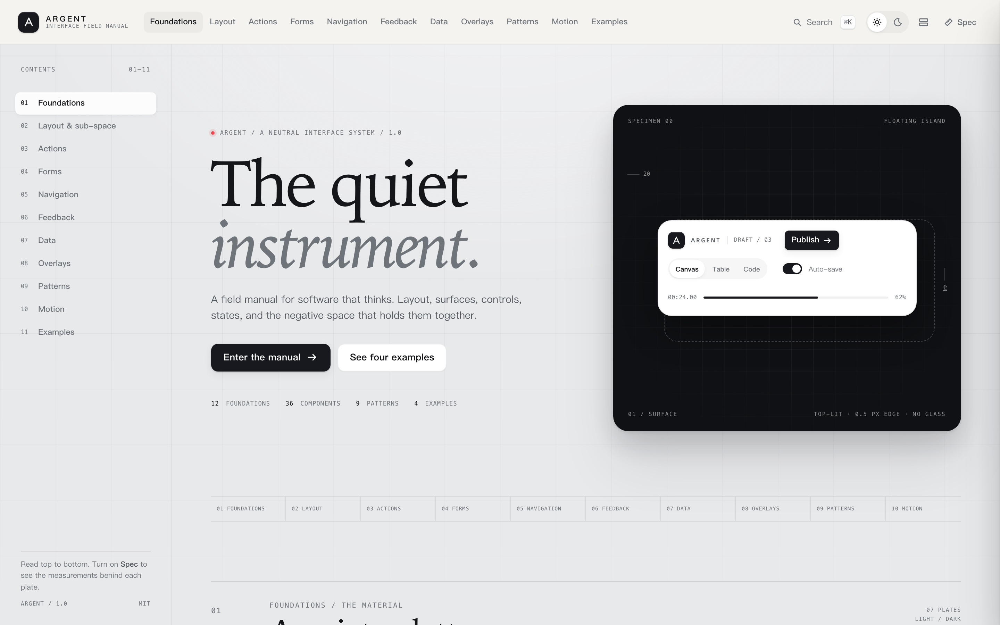
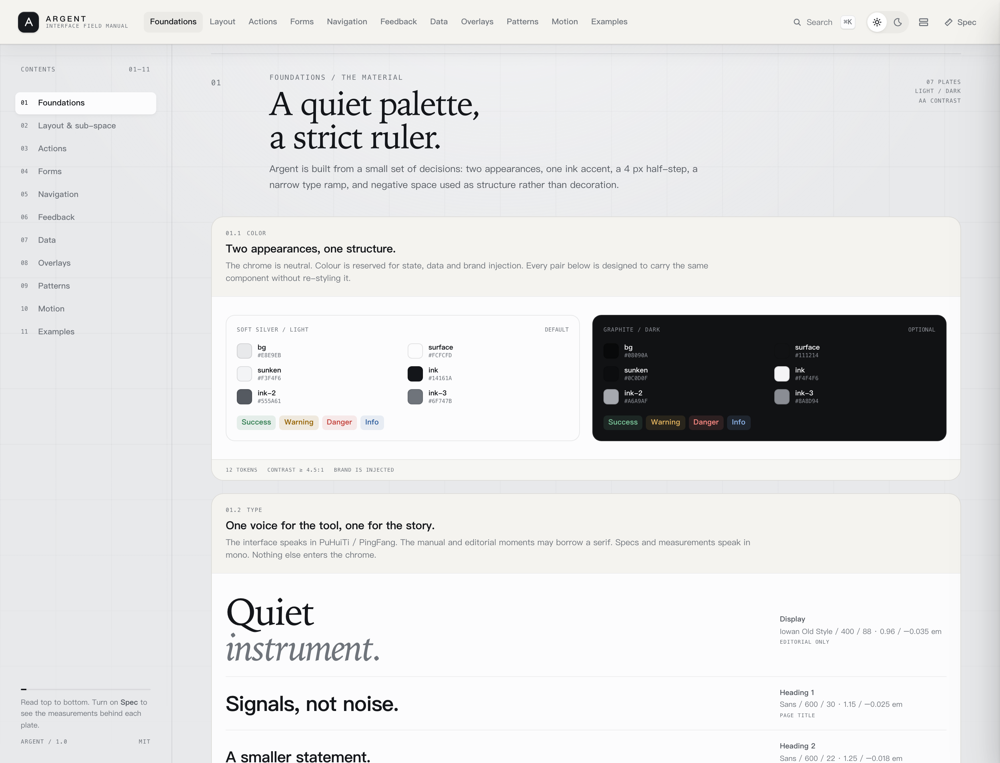

# Argent

**银为面，石墨为骨。** 一套中性的 UI/UX 模板系统，来自对开源录屏工具 DogSC 的研读，但不再绑定录屏。

它把界面拆成四层：**空间**（主空间 / 副空间 / 临时空间 / 负空间）、**表面**（停靠带 / 浮岛 / 卡片 / 瓦片 / 凹槽）、**控件**（按钮、输入、导航、反馈、数据、弹层）、**行为**（状态、动效、保存、撤销、确认、渐进披露）。组件实验室是这套系统的视觉手册；三个跨领域示例证明它不是某个行业的皮肤。

[组件实验室](examples/lab/index.html) · [Pulse 数据分析](examples/pulse/index.html) · [Atelier 设置](examples/settings/index.html) · [Relay 引导](examples/onboarding/index.html) · [Motion 领域示例](examples/motion/index.html)

## 为什么是 Argent

Argent 是“银”。银反射工作，而不是抢工作。它足够中性，可以进数据分析、后台、设置、编辑器、导入流程；也足够有性格，不会变成一张没有记忆点的 Bootstrap 页面。

这套东西不是从“好看”开始的，而是从四个问题开始的：

1. **怎么布局？** 屏幕不是一块画布，是五种空间：Chrome、Primary、Secondary、Tertiary、Negative。每种空间有自己的节奏，副空间不能继承主空间的 40px。
2. **负空间是什么？** 不是剩余，是材料。4/8/12/16/24/32/48/64 的尺子；先靠距离分组，再考虑边框。
3. **操作怎么展示？** 一个表面只有一个主操作；其余按重量分成 secondary / quiet / danger；状态用 wash，而不是彩色背景。
4. **UX 怎么落地？** 保存状态、撤销、危险确认、批量、向导、空/加载/错误、命令面板、键盘与焦点——这些不是“组件”，是决策。

## 四层

| 层 | 内容 | 关键规则 |
| --- | --- | --- |
| 空间 | Chrome / Primary / Secondary / Tertiary / Negative | 主 40/32/24，副 20/16/8，临时 12/8/4 |
| 表面 | Dock / Island / Card / Tile / Well | 停靠带平；只有浮岛有阴影；一层的表面只用一个主材质 |
| 控件 | 按钮、字段、导航、反馈、数据、弹层 | 30/34/40 高度；状态先于装饰 |
| 行为 | hover/open/pressed/selected/disabled/loading/error/dirty | 150/140/320–380ms；不弹跳；可撤销优先于确认 |

## 里面有什么

- **组件实验室**：11 章、40+ 块样板。基础（颜色/字/间距/圆角/阴影/动效/品牌/密度）、布局与副空间、操作、表单、导航、反馈、数据、弹层、模式、动效、示例。右上角可以切明暗、密度和 **Spec 模式**（8px 网格 + 标注）。
- **三个跨领域示例**：Pulse（数据后台：统计、图表、可选表格、右侧检查器）、Atelier（设置：表单、成员、保存条、危险区）、Relay（引导：四步导入、校验、成功状态）。
- **一个领域示例**：Motion——最初的录屏/剪辑研究样本，降级为 1/4，只用来展示同一套语言能走多深。
- **组件库**：assets/argent.css（令牌 + 布局 + 全组件 + 明暗 + 密度）和 assets/argent.js（图标、主题/密度/品牌、标签页、分段、弹层、对话框、抽屉、命令面板、Toast、复制、滑杆、步进器、表格选择）。
- **技能**：SKILL.md 是 agent 入口，references/ 里有布局、组件、UX 模式、基础和 DogSC 研究附录。

## 快速开始

~~~html
<link rel="stylesheet" href="assets/argent.css">

  <button class="ag-btn ag-btn-primary">Publish</button>
  <button class="ag-btn ag-btn-secondary">Duplicate</button>

~~~

~~~html
<html data-theme="dark" data-density="compact" data-brand="graphite">
~~~

- 主题：data-theme="light" / "dark"
- 密度：data-density="comfortable" / "compact"
- 品牌：data-brand="graphite" / "cobalt" / "moss" / "clay"
- 图标：span data-icon="plus"（由 argent.js 注入）
- 分段 / 标签页 / 弹层 / 对话框：data-segment / data-tabs / data-popover / data-dialog
- Toast：Argent.toast({ title, text, type })

没有构建步骤。字体是阿里巴巴普惠体 3.0 的子集（assets/fonts，自带授权），断网也能看。

## 三个示例

| 示例 | 展示什么 | 关键文件 |
| --- | --- | --- |
| Pulse | 数据密度、检查器、可选表格、批量条、图表 | examples/pulse |
| Atelier | 表单、角色、保存状态、危险区、对话框 | examples/settings |
| Relay | 向导、校验、加载、成功、渐进披露 | examples/onboarding |
| Motion | 画布、检查器、时间线、领域色 | examples/motion |

## 作为技能使用

把整个目录放到技能目录，或直接读取 SKILL.md：

~~~bash
open examples/lab/index.html
~~~

SKILL.md 是给 agent 的工作流和规则；references/ 是它在需要时展开的细节：

- layout.md：五种空间、副空间、负空间、断点、密度
- components.md：组件清单、解剖、状态、可访问性
- ux-patterns.md：保存、撤销、危险确认、渐进披露、批量、向导、空/加载/错误、命令面板、权限、长任务
- foundations.md：颜色、字体、间距、圆角、阴影、动效、图标
- dogsc-study.md：从 DogSC 学到了什么，故意留下了什么

## 目录

~~~text
argent/
  SKILL.md
  README.md
  CREDITS.md
  assets/
    argent.css
    argent.js
    fonts/
  examples/
    lab/         组件实验室 + 2x 截图
    pulse/       数据后台
    settings/    设置
    onboarding/  引导流程
    motion/      最初的领域样本（独立快照）
  references/
    layout.md
    components.md
    ux-patterns.md
    foundations.md
    dogsc-study.md
~~~

## 设计取舍

- **不做玻璃。** 磨砂会把“仪器感”变成“装饰感”，也会牺牲对比度。
- **不把每个组都装进卡片。** 先靠负空间分组；卡片是最后的结构，不是默认。
- **不给每个轨道上色。** 颜色是身份（数据/状态/品牌），不是气氛。
- **不把副空间做成第二个主空间。** 检查器就该更紧、更窄、自己滚。
- **不为了动效而动效。** 动效只做四件事：确认按压、携带选择、解释来源、归还焦点。

## 来源与授权

- 设计研究：DogSC（https://github.com/laogou717/dogsc，MIT）。保留了它的 Soft Silver / Graphite、停靠工作台、浮岛材质、字阶和检查器节奏；没有把录屏垂直领域当成系统。详见 CREDITS.md 和 references/dogsc-study.md。
- 字体：Alibaba PuHuiTi 3.0 子集，阿里巴巴字体授权；见 assets/fonts/。
- 插画、图标、壁纸、波形：CSS / 内联 SVG / JavaScript 生成，无第三方图片。
- 代码：本仓库独立实现；MIT（如沿用，请保留来源说明）。
